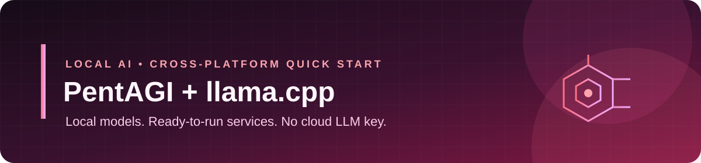

**PentAGI powered by llama.cpp and local GGUF models**

One quick start for the app, model, embeddings, database, and dependencies.

Run PentAGI with a local llama.cpp model on Windows, macOS, or Linux. End users
install the platform app, open its desktop shortcut, choose a worker profile,
and complete setup in the app. They do not need Node.js, npm, or a terminal.

> **Upstream architecture preserved.** This repository adds a bootstrap layer
> and a Compose override for llama.cpp; upstream source and model weights are
> fetched during setup rather than copied into this repository.

## One-time prerequisite: Docker

- Install Docker Desktop on Windows/macOS, or Docker Engine with the Compose v2
  plugin on Linux. The desktop app intentionally does not install system-level
  Docker software or request administrator privileges.
- Start Docker and complete its first-run setup before starting PentAGI.
- Enable Docker at sign-in/startup so the services can be ready when you open
  PentAGI Local:
  - **Windows/macOS:** Docker Desktop → **Settings → General → Start Docker
    Desktop when you sign in to your computer**.
  - **Linux:** follow Docker's [post-installation instructions](https://docs.docker.com/engine/install/linux-postinstall/)
    and enable the `docker` service at startup. Membership in the `docker`
    group grants host-level privileges.
- [Install Docker Desktop](https://www.docker.com/products/docker-desktop/) on
  Windows/macOS, or [install Docker Engine](https://docs.docker.com/engine/install/)
  for your Linux distribution.
- At least 16 GB of system memory and 4 CPU cores recommended. The selected
  3B model runs on CPU by default; inference speed depends on your hardware.
  Allow about 40 GB of free disk space for containers and model downloads.
- An internet connection for the initial source, image, and model downloads.
  LLM inference and embeddings run locally after setup; no cloud model API key
  is required.

## Install and start the desktop app

Download the platform installer for **PentAGI Local** from this repository's
[Releases](https://github.com/omnichan0/My-pent/releases) page and install it.
On Windows, the installer creates a desktop and Start-menu shortcut and opens
PentAGI Local when installation finishes. On macOS/Linux, move or install the
app using the platform's normal installer flow. The Linux `.deb` package adds
PentAGI Local to the applications menu; the AppImage is a portable
alternative. Open **PentAGI Local** from the desktop shortcut or applications
menu:

- On first launch, the app checks available RAM and disk space, then lets you
  choose the maintained worker, a custom selection of extra tools, or the full
  Kali suite when the conservative resource threshold is met. The selected
  worker image is prepared and reused by later PentAGI tasks.
- Select **Install selected setup & start**. The app clones the pinned
  PentAGI source, downloads and checksum-verifies the selected chat and
  embedding models, generates private local credentials, starts the services,
  runs the tool-call and embedding/database tests, and opens PentAGI in its own
  desktop window after the tests pass. Keep the app open while first-run
  downloads and checks complete.
- On later launches, the app starts the prepared services and opens PentAGI.
  Enable **Open PentAGI Local when I sign in** in the app if you want the
  desktop app to launch automatically at sign-in. Docker must also be set to
  start with the operating system.
- The app window includes **Open PentAGI**, **Refresh status**, **View logs**,
  and **Stop services** controls. You do not need a terminal to manage it.
- Choose the maintained lean curated Kali image (200+ tools), its systemd
  variant, selected extra Kali packages, or the full Kali metapackage when the
  app's conservative resource check sees at least 32 GB RAM and 100 GB free
  disk. The curated/custom choices use the same roughly 6 GB upstream worker
  base; add-on selections do not avoid downloading it. These images are stored
  in Docker, not installed on the host. The full metapackage can take
  substantially more disk space; Docker Desktop's virtual disk capacity can
  differ from the host free-space estimate.
- See [Worker profiles and capabilities](#worker-profiles-and-capabilities)
  for a quick guide to the tools and resource tradeoffs in each choice.
- Windows and macOS may show an operating-system warning because release
  installers are not yet signed/notarized. Only install releases linked from
  this repository. The local model weights are downloaded and checksum-verified
  during first setup rather than bundled into a multi-gigabyte installer.

The first-run login is `admin@pentagi.com` with password `admin`; change it
immediately.

The desktop app's **Stop services** control stops containers without deleting
the runtime files or Docker volumes. The **View logs** control displays recent
service output. Generated credentials and model files stay in the app's local
data directory and are not included in Git or the app installer.

## Worker profiles and capabilities

PentAGI is an AI-assisted penetration-testing workspace. Its Kali worker
profiles provide a broad toolkit for authorized security assessments; they are
different sizes of reusable Docker worker image, not different Kali operating
systems installed on your computer.

- **Lean curated Kali (recommended):** the maintained upstream image with 200+
  command-line security tools. Examples span host and service discovery
  (Nmap, Masscan), web testing (Nuclei, Nikto, FFUF, SQLmap), DNS and
  reconnaissance (Amass, Subfinder), password auditing (John, Hashcat),
  exploitation and Windows-network testing (Metasploit, Impacket, NetExec),
  traffic analysis (TShark, tcpdump), and binary analysis (Binwalk, Radare2).
  It is the practical starting point for most machines, but the image itself
  is still about 6 GB or more.
- **Curated Kali + systemd:** the same curated tools with systemd support for
  tools that need to start or manage services inside the worker.
- **Curated Kali + chosen add-ons:** install a reusable image with the
  selected packages below, in addition to the curated base. This lets you
  tailor the environment, but it still downloads the roughly 6 GB base:
  `dnsenum` (DNS enumeration), `enum4linux-ng` (Windows/SMB enumeration),
  `testssl.sh` (TLS configuration checks), `net-snmp` (SNMP discovery and
  queries), `recon-ng` (modular reconnaissance), and `zmap` (network
  measurement and scanning).
- **Full Kali suite:** builds a reusable image with the `kali-linux-everything`
  metapackage. It is very large and is offered only when the app detects at
  least 32 GB RAM and 100 GB free disk. The app recommends the curated profile
  on less capable systems; the full suite can use substantially more storage
  than the initial estimate while building and updating.

PentAGI's capability depends on the worker tools, the authorized target and
scope, and the instructions you give the AI. Clear, bounded prompts and
security expertise help; AI output is not proof that a finding is real or
that an action is safe. Review plans and results, validate findings yourself,
and keep testing within written authorization. Worker containers can make
outbound network connections, and Docker socket access is effectively
host-level privilege; use an isolated machine and never expose this setup to
the public internet.

## What's configured

- PentAGI's upstream services, including PostgreSQL/pgvector and the isolated
  tool execution services.
- The G9v3-3B-Heretic-Abliterated-Q8_0 model via llama.cpp's OpenAI-compatible
  chat API, available to PentAGI's agent roles.
- Nomic Embed Text v1.5 via llama.cpp's embedding API for PentAGI memory and
  vector search.
- Per-agent inference settings, an 8K chat context, and a bounded output size
  suited to this local model.
- Random local credentials and localhost-only access; the LLM services are
  reachable by PentAGI over its internal Docker network and are not published
  to the LAN.

## Safety and licensing

Use PentAGI only against systems you own or are explicitly authorized to test.
PentAGI can execute security tools in worker containers. Docker worker
containers use normal Docker networking and can make outbound network
connections; containerization does not mean the agent is offline. The standard
deployment gives PentAGI access to the Docker API; Docker socket access is
effectively host-level privilege, so use a dedicated or otherwise isolated
machine and do not expose this local setup to the public internet. USB devices
are not automatically passed into containers; any future host-device
integration should require a deliberate, per-device permission.

The selected G9v3 model is described by its publisher as an abliterated,
uncensored variant with reduced refusal behavior. That model behavior is a
deliberate selection, not a PentAGI safeguard. The G9v3 and Nomic model files
are downloaded from their publishers under Apache-2.0 terms; their weights are
not included in Git. PentAGI and llama.cpp remain their respective upstream
projects and licenses; their source is fetched into the ignored runtime
directory rather than vendored here.
